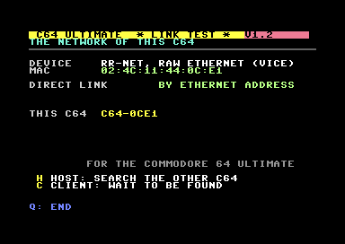
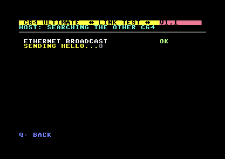
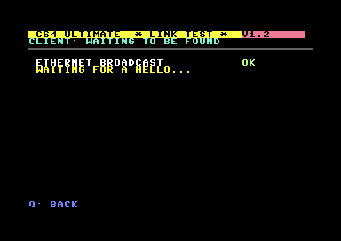
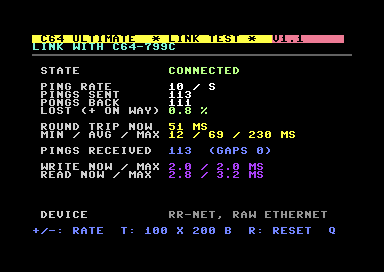
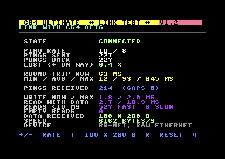

# C64U-H2H: C64 Ultimate head-to-head link test

A test program for **two C64 Ultimates that talk to each other directly**, without a server
in between. It shows the network of each C64, lets the two find each other, and measures the
link: round trip, packet loss, how long a socket write and read through the Ultimate's Command
Interface take, and the speed of a burst of data. Black screen, bright colours.

<p align="center">
  
  
  
</p>
<p align="center">
  
  
  
</p>

*The screenshots come from two VICEs with an RR-Net cartridge; round trips and speeds in VICE say
little about real hardware. On two real C64 Ultimates a socket write and read take 2.5-3.5 ms.*

## Why

The Ultimate's Command Interface could only open UDP and TCP sockets *to* someone: the local port
was always random and there was no listener, so two Ultimates could not reach each other. With
the new command **OPEN_UDP_LOCAL (`$0A`)**, a UDP socket from a fixed local port, two Ultimates
each open a socket from port 6464 to the other's port 6464 and talk directly
([GideonZ/1541ultimate#962](https://github.com/GideonZ/1541ultimate/issues/962), pull request
[#1016](https://github.com/GideonZ/1541ultimate/pull/1016) by JC-000). This program tests exactly
that, on real hardware.

## What you need

- Two C64 Ultimates (or Ultimate 64s) on the same network, LAN or WiFi (turn it on in the
  Ultimate's menu).
- Firmware with `$0A`. Until it is released: the test build linked in issue #962. The program
  checks at the start: "DIRECT LINK ($0A): SUPPORTED" or "NOT IN THIS FIRMWARE".
- Or, to try it in an emulator: two VICEs with an **RR-Net** cartridge on the same host network
  adapter. They then send raw Ethernet frames (EtherType `$88B5`) to each other.

## Use

Put [release/linktest.d64](release/linktest.d64) on both C64s (or `linktest.prg`) and
`LOAD"*",8,1` / `RUN`.

1. The first screen shows the network of the C64: the Command Interface, every interface with its
   MAC address, IP address, netmask and gateway, and whether the firmware has `$0A`.
2. On one C64 press **C** (CLIENT: wait to be found), on the other **H** (HOST: search).
   Or press **I** on both and type the other C64's IP address.
3. The link screen updates four times a second:

| | |
|---|---|
| STATE | CONNECTED, or NO ANSWER after 2 seconds without a message |
| PING RATE, SENT, BACK, LOST | pings per second (`+`/`-`), pings sent, pongs back, lost (pings still on the way count until they arrive) |
| ROUND TRIP | now, and min / avg / max, on the C64's own clock (a 32-bit cycle counter) |
| PINGS RECEIVED | the other C64's pings, and gaps in their numbering |
| WRITE NOW / MAX | how long one socket write through the Command Interface takes |
| READ WITH DATA | how long a socket read that brought a message took, now and max |
| READS <10 MS | reads that brought a message: fast (under 10 ms) and slow. A read waits up to 40 ms when the socket is empty; if it returns as soon as a datagram arrives, nearly all of them are fast |
| EMPTY READS | reads that found nothing (each waits up to 40 ms) |
| DATA RECEIVED, SPEED | after `T` on the other C64: 100 messages of 200 bytes as fast as possible |

`R` resets the counters, `Q` goes back to the menu.

## How the two find each other

A `$0A` socket is *connected*: it only receives from the address and port it was opened to. A
normal LAN scan is therefore not possible. The search tries two things that the Ultimate's network
stack (lwIP) may allow. The screen shows every step with the firmware's status, so the test also
tells which of them works:

1. The **CLIENT** opens `$0A` to **0.0.0.0**, remote port 6465, local port 6464. lwIP matches a
   connected socket whose remote address is "any" against every sender.
2. The **HOST** sends HELLO (with its own IP address) from port 6465 to the subnet's
   **broadcast address**, port 6464, every half second, and listens itself on 0.0.0.0:6464.
3. The CLIENT answers with ACK (its IP address). Then both open `$0A` to each other, 6464 to 6464,
   and the HOST starts pinging.
4. The CLIENT waits up to 3 seconds for those pings. Without them the HELLO was an old one (a HOST
   that stopped searching), and the CLIENT waits again.

If a step fails, use **I** on both C64s and type the other's IP address: that needs nothing but
`$0A`.

## Messages

`'L' 'T' type seq(2) time(4) ip(4) name(8) [data]`: 21 bytes before the data.

| Type | | |
|---|---|---|
| 1 | HELLO | HOST to the broadcast address |
| 2 | ACK | CLIENT to the HOST (three times) |
| 3 | PING | |
| 4 | PONG | the PING with its time, back to the sender |
| 5 | BYE | when a side leaves the link screen |
| 6 | DATA | 200 bytes, the burst of `T` |

## Building

[cc65](https://cc65.github.io/) and, for the disk, VICE's `c1541`:

```bash
python build.py          # build/linktest.prg and build/linktest.d64
python build.py run      # and start it in VICE with an RR-Net cartridge (set NPCAP_IF)
```

The tools are found through `CC65_BIN` and `VICE_DIR` (their `bin` folders) or the PATH.

| File | |
|---|---|
| `src/main.c` | the program |
| `src/timer.s` | the cycle counter (CIA 2 timers A and B chained) |
| `src/uci.s` | the Ultimate Command Interface driver |
| `src/rrnet.s` | the RR-Net (CS8900a) raw Ethernet driver |

The two drivers come from the [Commodore 64 Game Server](https://github.com/mfidder2026/Commodore64_Gameserver),
where the same C64s play games online through a server.

## Status

Tested on two real C64 Ultimates with the `$0A` test firmware (the IP address by hand), and in VICE
(two RR-Net instances): finding each other, the link and the burst. Results are welcome in issue
#962.

| Version | |
|---|---|
| 1.2 | Reads that brought data are measured apart from empty ones (fast / slow / empty), to show whether a read that waits returns as soon as a datagram arrives. At most 12 screen lines a second, so drawing delays incoming messages less. |
| 1.1 | Reads every waiting message per pass and draws one screen line per pass (1.0 read one message per pass while it redrew the whole screen: on real Ultimates a queue built up, round trips of 4 seconds and 90 % loss). HOST and CLIENT instead of MASTER and SLAVE (keys H and C). The CLIENT checks that the HOST answers (an old HELLO no longer starts a link). The other C64's name also when it was found by its IP address. |
| 1.0 | First release |

## In a game

**Wizard of Wor OME** uses the same technique for head-to-head play between two C64 Ultimates, without a server:
one Ultimate hosts, the other presses RETURN and finds the host on the LAN by itself (the host announces itself
by UDP broadcast). Verified on two real C64 Ultimates. Download: `wizardofwor.d64` in
[C64 Game Server 1.2](https://github.com/mfidder2026/Commodore64_Gameserver/releases/tag/v1.2).

See [NOTICE.md](NOTICE.md) for third-party code.
